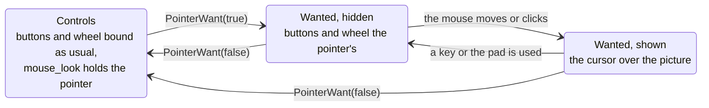

# Keyboard and mouse

Controller 1 is the keyboard and mouse as well as the first pad: a game finds a controller in port 1 with no pad
plugged in, and a pad there plays alongside the keys. Ports 2 to 4 are pads only. `keyboard_mouse = false` in the
settings file leaves port 1 to the pad alone, as before.

**Figure 1.** Where controller 1's buttons come from.


Keys reach the game only while its window is in front, and mouse buttons only while the pointer is over it, so typing
in another window never presses anything.

## Controls

The `[controls]` table of the settings file binds each control to up to four keys or mouse buttons, as a list or one
string with spaces:

```toml
[controls]
a = ["key:E", "key:RETURN"]
rtrigger = "mouse:left"
lstick_up = "key:W"
black = []   # nothing
```

A control the table leaves out keeps its default. The defaults are the game's (`GameInfo::controls`) over the built-in
keys below, and a control the game names replaces its built-in keys.

| Controls | |
| --- | --- |
| `a` `b` `x` `y` `black` `white` | the face buttons |
| `ltrigger` `rtrigger` | the triggers, pulled all the way |
| `start` `back` | |
| `dpad_up` `dpad_down` `dpad_left` `dpad_right` | |
| `lstick_up` `lstick_down` `lstick_left` `lstick_right` | the left stick, pushed all the way |
| `rstick_up` `rstick_down` `rstick_left` `rstick_right` | the right stick |
| `lthumb` `rthumb` | the sticks pressed in |

| Sources | |
| --- | --- |
| `key:W`, `key:7` | a letter or digit |
| `key:RETURN`, `key:LCTRL`, `key:F8`, `key:SLASH` | a named key, the names DirectXbox-Recomp's input files use (`kKeys` in `runtime/core/input.cpp`) |
| `key:#191` | a Windows virtual key code, for a key with no name |
| `mouse:left` `mouse:right` `mouse:middle` `mouse:x1` `mouse:x2` | the mouse buttons, x1 and x2 the side buttons; `left` is the primary button, the right one when Windows swaps them |
| `mouse:wheel_up` `mouse:wheel_down` | one press for each notch of the wheel |

The built-in keys: arrows for the D-pad, Enter Start, Backspace Back, Z X A S for A B X Y, Q White, W Black, E and R
the left and right triggers.

## Mouse look

`mouse_look = true` turns the mouse into controller 1's right stick: the stick is pushed in proportion to how fast the
mouse moves, added to what a pad pushes. `mouse_sensitivity`, 1 to 100 (80 by default), is how far a given speed
pushes it. While the game window is in front the pointer is hidden and held inside it; Alt+Tab lets it go. A game
turns it on by default with `GameInfo::mouse_look`.

A stick says how fast to turn, not how far, so a game whose aim should follow the mouse exactly is better served by
a hook of its own in `src/game` that turns the camera by the mouse's movement.

## Pointer

A game that draws its own menus can let the mouse point and click in them. `input::PointerWant(true)` while a menu is
up asks for the pointer and `input::PointerWant(false)` lets it go; `input::GetPointer()` then says where it is over the
game's picture and what the mouse did. Each caller pairs its own calls, and the pointer is wanted while any of them wants
it, so a game's menus and an overlay of its own can each ask without undoing the other.

**Figure 2.** Who the mouse belongs to.



While the pointer is wanted:

- mouse_look lets the pointer go, and holds it again when the want ends;
- the mouse's buttons and wheel are the pointer's and press no control, so a click in a menu does not also fire. A
  button held when the want ends stays the pointer's until it is let go: the click that closed the menu does not fire
  either;
- the cursor shows when the mouse moves or clicks and hides when a key or controller 1's pad is used, so a player who
  never touches the mouse never sees it.

| `input::Pointer` | |
| --- | --- |
| `inside` | over the picture, the window in front and the pointer wanted |
| `shown` | the cursor is showing: a game highlights what it is over only then, so keys and the pad keep their own selection |
| `x` `y` | across and down the picture, 0 to 1 inside it, below 0 or past 1 in the black bars |
| `aspect` | the picture's width over its height as shown, 4:3 or 16:9 (`app::Widescreen()`) |
| `moved` | counts moves: a game that sees it change hovers again |
| `held` | the buttons held, 1 left, 2 right, 4 middle, 8 and 16 the side buttons |
| `presses[5]` | counts each button's presses, so a click shorter than a frame is not lost |
| `wheel` | the notches turned while wanted, up positive, as a running total |

The counters only grow, so any number of readers on any thread each keep the last value they saw and act on the
difference. The picture is where the renderers draw it: the window's client area letterboxed to the picture's aspect,
as `D3D9Backend::FrameRect` does, so `x` and `y` map onto the game's own screen by its width and height (640 by 480 on
most titles) whatever the window's size.

`input::LastUsed()` is the last of keyboard, mouse or pad controller 1 used, for a menu that names keys when the
keyboard is in use and the pad's buttons when the pad is. `input::ControlName("a")` is the first key or mouse button
bound to a control as the keyboard calls it ("Enter", "Left Mouse", "" when nothing is), and `input::KeyName(VK_ESCAPE)`
names any key ("Esc"), in the keyboard's own language.

```cpp
input::PointerWant(menu_up);
input::Pointer p = input::GetPointer();
if (p.shown && p.inside && p.moved != last.moved) Hover(p.x * 640, p.y * 480);
if (p.presses[0] != last.presses[0] && p.inside) Click(p.x * 640, p.y * 480);
last = p;
```

## For game repos

```cpp
.controls = {{"lstick_up", "key:W"}, {"rtrigger", "mouse:left"}, {"black", ""}},
.mouse_look = true,
```

`GameInfo::pad` still sees each polled pad last, keyboard and mouse included, which is where a game changes what a
key does in its menus. `input::KeyboardMouse()` there is what the keyboard and mouse alone held at that poll, so a
key can be told from the pad's button it is bound to: TimeSplitters 2 turns Escape (Start) into B in its front end.
