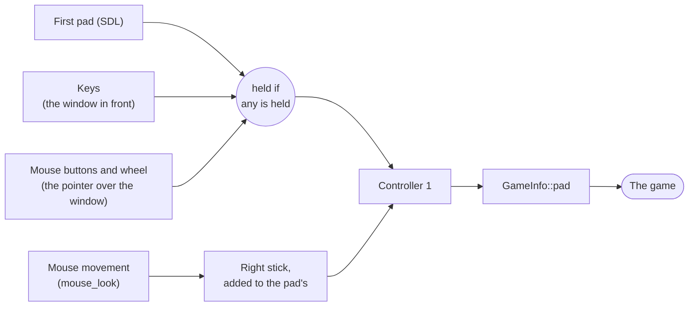

# Keyboard and mouse

Controller 1 is the keyboard and mouse as well as the first pad: a game finds a controller in port 1 with no pad
plugged in, and a pad there plays alongside the keys. Ports 2 to 4 are pads only. `keyboard_mouse = false` in the
settings file leaves port 1 to the pad alone, as before.

**Figure 1.** Where controller 1's buttons come from.



Keys reach the game only while its window is in front, and mouse buttons only while the pointer is over it, so typing
in another window never presses anything.

## Controls

The `[controls]` table of the settings file binds each control to up to four keys or mouse buttons, as a list or one
string with spaces:

```toml
[controls]
a = ["key:E", "key:RETURN"]
rtrigger = "mouse:left"
lstick_up = "key:W"
black = []   # nothing
```

A control the table leaves out keeps its default. The defaults are the game's (`GameInfo::controls`) over the built-in
keys below, and a control the game names replaces its built-in keys.

| Controls | |
| --- | --- |
| `a` `b` `x` `y` `black` `white` | the face buttons |
| `ltrigger` `rtrigger` | the triggers, pulled all the way |
| `start` `back` | |
| `dpad_up` `dpad_down` `dpad_left` `dpad_right` | |
| `lstick_up` `lstick_down` `lstick_left` `lstick_right` | the left stick, pushed all the way |
| `rstick_up` `rstick_down` `rstick_left` `rstick_right` | the right stick |
| `lthumb` `rthumb` | the sticks pressed in |

| Sources | |
| --- | --- |
| `key:W`, `key:7` | a letter or digit |
| `key:RETURN`, `key:LCTRL`, `key:F8`, `key:SLASH` | a named key, the names DirectXbox-Recomp's input files use (`kKeys` in `runtime/core/input.cpp`) |
| `key:#191` | a Windows virtual key code, for a key with no name |
| `mouse:left` `mouse:right` `mouse:middle` `mouse:x1` `mouse:x2` | the mouse buttons, x1 and x2 the side buttons |
| `mouse:wheel_up` `mouse:wheel_down` | one press for each notch of the wheel |

The built-in keys: arrows for the D-pad, Enter Start, Backspace Back, Z X A S for A B X Y, Q White, W Black, E and R
the left and right triggers.

## Mouse look

`mouse_look = true` turns the mouse into controller 1's right stick: the stick is pushed in proportion to how fast the
mouse moves, added to what a pad pushes. `mouse_sensitivity`, 1 to 100 (80 by default), is how far a given speed
pushes it. While the game window is in front the pointer is hidden and held inside it; Alt+Tab lets it go. A game
turns it on by default with `GameInfo::mouse_look`.

A stick says how fast to turn, not how far, so a game whose aim should follow the mouse exactly is better served by
a hook of its own in `src/game` that turns the camera by the mouse's movement.

## For game repos

```cpp
.controls = {{"lstick_up", "key:W"}, {"rtrigger", "mouse:left"}, {"black", ""}},
.mouse_look = true,
```

`GameInfo::pad` still sees each polled pad last, keyboard and mouse included, which is where a game changes what a
key does in its menus.
