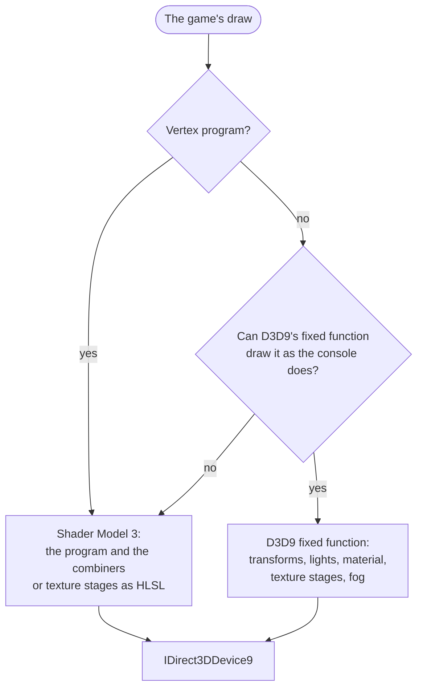

# Direct3D 9 renderer

`renderer = "d3d9"` in the settings file draws the game with Direct3D 9 instead of Direct3D 12 (the default). It is for
tools that hook Direct3D 9, such as RTX Remix: they see the game's draws as an ordinary D3D9 game makes them. Nothing in
it is about one game or one tool; what a tool needs beyond plain Direct3D 9 a [mod](mods.md) adds.

## How a draw is made

**Figure 1.** Each draw goes one of two ways.

Fixed function draws stay fixed function wherever Direct3D 9's pipeline can do what the console's does, so a tool sees
real transforms, lights and texture stages. They go to the shaders instead under a combiner program, alpha kill, a
shadow (depth) texture, a texture read across an upscaled target, projected coordinates into a linear texture, or
two-sided lighting. Screen space draws (`XYZRHW`) are drawn as positions under an orthographic projection, which tools
accept where they drop pre-transformed vertices.

Inputs are named by what they hold, not by their register: a program's input that reaches `oPos` is `POSITION`, one a
matrix rotates `NORMAL`, the one alone feeding `oD0` `COLOR0`, `oTn` `TEXCOORDn`. TimeSplitters 2 keeps position in v1,
colour in v2 and coordinates in v3, which named by habit would be a blend weight, a normal and a colour.

## The device

| | |
| --- | --- |
| Device | `Direct3DCreate9Ex` when there is one (a windowed device that is never lost), else `Direct3DCreate9` with a reset after a loss; hardware vertex processing |
| Back buffer | the scene's size (the console's times the render scale); the window gets it letterboxed 4:3 or 16:9 through Present's destination rectangle |
| Targets | `A8R8G8B8` render target textures; depth `INTZ` when the driver samples it, else `D24S8` |
| Vertices and indices | dynamic rings, 64 MB and 16 MB, indices rebased to the first vertex |
| Textures | default pool, filled through system memory copies; texture pack images in BGRA, RGBA or BC1 to BC3 |
| Pixel centres | Direct3D 9's half pixel offset is put in each shader's output position, and into fixed function's PROJECTION |
| Visibility tests | occlusion queries, counted in console pixels |
| Gamma | a pixel shader pass with the ramp as a texture, only when the ramp is not the identity |
| Overlay | Dear ImGui's Direct3D 9 backend |

## Not here yet

- F3 frame capture and `gpu::Extension` are Direct3D 12's alone.
- BC7 texture pack images have no Direct3D 9 format; the game's own texture stays.
- Shaders are compiled with `D3DCompile` at their first draw, so a new effect can stutter once.

## For tool and mod authors

The register layout of the generated vertex shaders, `RHI_MOD_POSITION` and `RHI_MOD_NORMAL` are in
[mods.md](mods.md#vertex-shaders); how WORLD, VIEW and PROJECTION reach the device under a vertex shader is in
[mods.md](mods.md#the-camera).

## Finding a draw's part in a frame

With a mod hooking the draws, the log reports every ten seconds what the mods were given to find the camera in: the
program draws, how many draw the screen, read the projection or count as 2D, the first 3D draw's VIEW and PROJECTION
as left on the device, and for the last frame where the first draw a mod marked with a vertex texture fell (RTX Remix's
UI mark, where Remix puts its picture in) and the draws, copies and clears after it. Each draw in those lists says which
camera Remix takes from the transforms on the device: `main`, `sky` (a depth range starting at 1), `none` (an identity
PROJECTION, or a VIEW that leaves WORLD as it is) or `rejected` (a projection leaning sideways over 0.01 radian, or an
orthographic one), with its field of view and lean in degrees. Remix puts its picture in only when a draw before the
mark gave it a main camera that frame. A draw marked `counted` is inside one of the title's visibility tests (an occlusion
query), and Remix only rasterises those: it neither traces one nor takes it for the UI. Fixed function draws are listed too, and
one Remix takes for the UI by its own rule (no vertex shader, an orthographic PROJECTION, no depth written) says so: Remix
puts its picture in at the first such draw as at a marked one, so one before the frame's 3D loses the frame. Each program is named by a hash;
`XBE_D3D9_SKIP_PROGRAMS=<hash>,<hash>` leaves those programs' draws out, so a draw's part in a picture can be found by
running without it. `XBE_D3D9_SOLID` draws every pixel shader magenta. `XBE_D3D9_PRIME=1` binds a target one row taller than the back
buffer before each frame's first draw and binds the title's back; `=2` also draws a pixel into it, `=3` draws the frame's
first draw into it as well, as the title made it, and `=4` only fills it black. It is a test of what RTX Remix needs from
a frame before it puts its picture in at the UI.
