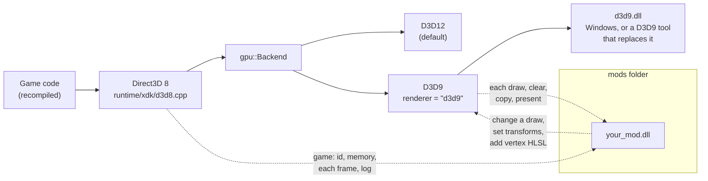
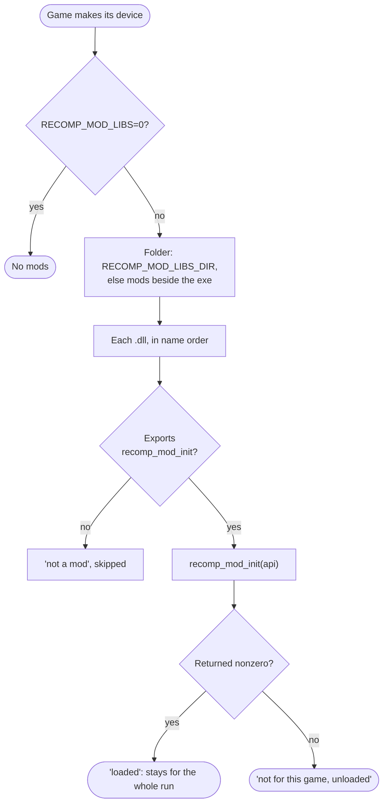
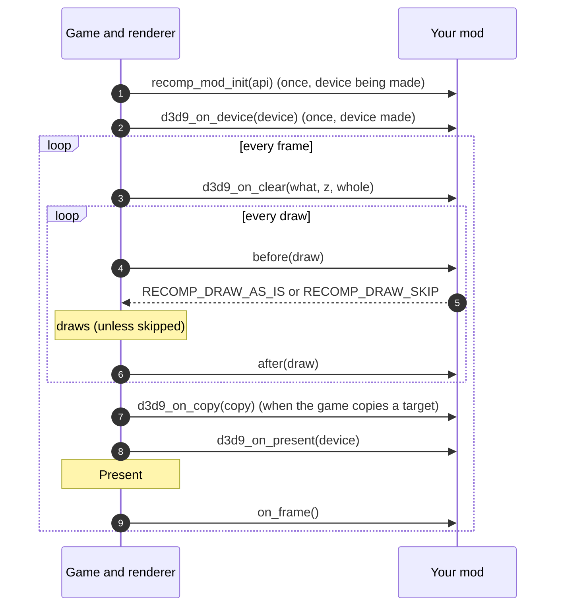
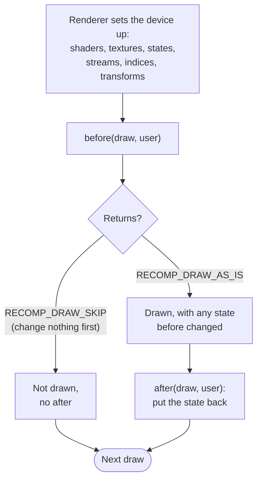
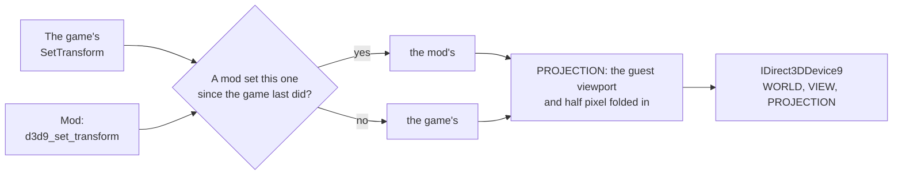

# Mods

A recompiled game is a native program, so a player can change it the way PC games have long been changed: by dropping
a library beside it. The SDK gives such libraries one small, versioned C contract,
[`runtime/mods/recomp_mod.h`](../runtime/mods/recomp_mod.h), so a change to a game can live outside the game's build:
the port stays the port, and a mod is something a player chooses to add.

The contract is the DirectXbox-Recomp toolkit's, field for field up to version 5, so one build of a mod loads under a
game built with either; version 6 (`pointer_elsewhere`) is this SDK's so far, and a mod checks for it. This page is the modder's guide: what a mod can do here, how to build and load one, every hook and
when it is called. The header is the field by field reference; this page is the map.

**Contents:** [At a glance](#at-a-glance) · [Where a mod sits](#where-a-mod-sits) · [Your first mod](#your-first-mod) ·
[Loading](#loading) · [A frame, hook by hook](#a-frame-hook-by-hook) · [Hook reference](#hook-reference) ·
[Changing a draw](#changing-a-draw) · [The camera](#the-camera) · [Telling models apart](#telling-models-apart) ·
[Vertex shaders](#vertex-shaders) · [Threads](#threads) · [An overlay's mouse](#an-overlays-mouse) ·
[Versions](#versions) ·
[Where a change belongs](#where-a-change-belongs) · [Troubleshooting](#troubleshooting) ·
[Keeping this guide current](#keeping-this-guide-current)

## At a glance

| You want to... | Use | Renderer |
| --- | --- | --- |
| Read the game's state (score, health, camera) each frame | `guest_pointer` + `on_frame` | any |
| Write a line in the game's log | `log` | any |
| Hide, recolour or retexture particular draws | `d3d9_on_draw` | D3D9 |
| Tell a D3D9 tool (RTX Remix) where the camera is | `d3d9_set_transform` from `before` | D3D9 |
| Move or bend every vertex shader's output, or its normal | `d3d9_vertex_hlsl` | D3D9 |
| Tell which of the game's models a draw is | `draw_vertex_buffer` from `before` | D3D9 |
| Replace what a mirror, monitor or blur reads | `d3d9_on_copy` | D3D9 |
| Do something at the start or end of a frame | `d3d9_on_clear`, `d3d9_on_present` | D3D9 |
| Give the mouse and keyboard to an overlay with its own cursor | `pointer_elsewhere` | any |

The D3D9 renderer is picked with `renderer = "d3d9"` in the settings file ([d3d9.md](d3d9.md)). Nothing in the
contract names a game or a tool: a mod for one game checks the game it is loaded into and unloads itself from any
other. Texture packs are not mods; they go in `textures\replacement\` beside the exe.

## Where a mod sits

**Figure 1.** The game's code draws through the SDK's Direct3D 8 and a renderer. A mod is a separate library beside
the game; the SDK hands it the hooks (dashed) and it never links against the SDK.



Under D3D12 a mod still loads and gets the game level calls (the top dashed line); the per draw hooks are the D3D9
renderer's.

## Your first mod

**Figure 2.** What goes where.

```text
<game folder>/
├── Game.exe                 the port
└── mods/
    └── hello_mod.dll        your mod
```

1. **Copy the header.** `recomp_mod.h` stands alone (it includes only `<stddef.h>` and `<stdint.h>`). Put a copy beside
   your source; you do not build against the SDK.
2. **Write `recomp_mod_init`.** Check the version and the game, register the hooks you want, return 1 to stay loaded.

   ```c
   #include "recomp_mod.h"

   static const RecompModApi *g_api;
   static unsigned g_frames;

   static void each_frame(void *user)
   {
       (void)user;
       if (++g_frames % 600 == 0)
           g_api->log("hello: ten more seconds at 60 fps");
       /* read the game's state through g_api->guest_pointer(...) */
   }

   __declspec(dllexport) int recomp_mod_init(const RecompModApi *api)
   {
       if (api->version < 3 || api->title_id() != 0x4553000Au)
           return 0;                       /* not ours: unload */
       g_api = api;
       api->on_frame(each_frame, NULL);
       api->log("hello: loaded");
       return 1;
   }
   ```

3. **Build it as a 64 bit DLL**, like the game: `clang -shared -O2 hello_mod.c -o hello_mod.dll`, or with MSVC
   `cl /LD /O2 hello_mod.c /Fe:hello_mod.dll`.
4. **Drop it in `mods` and start the game.** The log says what happened:

   ```text
   [MOD] hello: loaded
   [MOD] hello_mod.dll: loaded
   [MOD] 1 of 1 in <game folder>\mods loaded
   ```

## Loading

**Figure 3.** Which libraries are mods. It runs once, as the game first makes its Direct3D device, so before the
renderer starts and before the game's first draw.



| Setting | Effect |
| --- | --- |
| *(nothing)* | every mod in `mods` beside the exe |
| `RECOMP_MOD_LIBS=0` | no mods at all, for comparing with and without |
| `RECOMP_MOD_LIBS_DIR=<folder>` | mods from that folder instead |

Up to 16 mods load from one folder. Name order is load order, and for hooks where the first answer wins
(`d3d9_on_copy`) it is priority: prefix names (`10_`, `20_`) to choose.

## A frame, hook by hook

**Figure 4.** The order in which a loaded mod hears of things under the D3D9 renderer.



Clears and copies come where the game makes them, in among the draws; the figure shows one of each.

## Hook reference

**Figure 5.** Every entry in `RecompModApi`, when it applies, and under which renderer. ✓ works, – does nothing (or
returns 0 / NULL).

| Entry | Called or usable | D3D12 | D3D9 | Limit |
| --- | --- | :---: | :---: | --- |
| `title_id`, `title_name` | any time | ✓ | ✓ | |
| `guest_pointer` | any time | ✓ | ✓ | |
| `on_frame` | after each frame is shown | ✓ | ✓ | 16 |
| `vertex_constants` | inside a draw hook | – (0) | ✓ | |
| `log` | any time | ✓ | ✓ | |
| `d3d9_on_device` | once, device made | – | ✓ | 8 |
| `d3d9_on_draw` | before and after each draw | – | ✓ | 8 |
| `d3d9_on_clear` | each clear | – | ✓ | 8 |
| `d3d9_on_present` | before each Present | – | ✓ | 8 |
| `d3d9_vertex_hlsl` | from init only | – | ✓ | 16 KB |
| `d3d9_render_state` | inside a draw hook | – | ✓ | |
| `d3d9_set_projection` | from `before` or `after` | – | ✓ | |
| `d3d9_set_transform` | from `before`, or any time | – | ✓ | |
| `d3d9_remake_written_textures` | from init or `d3d9_on_device` | – | ✓ | |
| `d3d9_on_copy` | before each copy of a target | – | ✓ | 8 |
| `draw_vertex_buffer` (v4) | inside a draw hook | – (0) | ✓ | |
| `d3d9_fixed_transform` (v5) | once the device is made; see Changing a draw | – | ✓ | |
| `pointer_elsewhere` (v6) | any time, any thread; each on paired with one off | ✓ | ✓ | |
| `replaying` | any time | ✓ (0) | ✓ (0) | |
| `capture_on_draw`, `capture_note`, `replay_on_note` | accepted, never called: this SDK makes no frame captures for replay | – | – | |

"Limit" is across all loaded mods; a registration past it returns 0, so check it.

## Changing a draw

`d3d9_on_draw` takes two functions. `before` sees a `RecompModDraw` describing the draw, after the renderer has set the
device up for it; it may change the device for this one draw or leave the draw out. `after` runs once it is drawn and
puts back what `before` changed. Only the game's own draws are reported (`title` is always 1); the renderer's own
passes (the gamma pass, the overlay) are not.

**Figure 6.** One draw through a mod's hooks.



**Figure 7.** What `RecompModDraw` tells you here.

| Group | Fields | Under this SDK |
| --- | --- | --- |
| Whose | `title`, `two_d`, `title_2d`, `clip_w`, `offscreen` | `two_d`: a program draw that does not read the game's projection registers, or reads an orthographic one; a fixed function draw in screen pixels or under an orthographic projection. `offscreen`: the target is not one the game presents. `title_2d` and `clip_w` are 0 |
| How | `program`, `program_id`, `fixed_transform`, `primitive`, `primitives` | `program_id` is the program's microcode hash; `fixed_transform`: a program fixed function may draw (asked for with `d3d9_fixed_transform`): `world` is its model-view and `view` identity. Fixed function takes it after the hooks only if no pixel shader is left bound, so a mod that wants it removes the pixel shader, sets the stages and moves the camera from `world` to `view`, and one that leaves the shader bound gets the program, with the transforms it set. `vertex_constants` holds the program's constants on such a draw; the device's are stale, as none are sent for fixed function. Draws to a target the title does not present are never offered, nor are draws fixed function has no form of: a linear texture under a pixel shader, alpha kill, a shadow compare, the wide taps of a shrinking pass, two sided lighting. With no mod no draw qualifies, and the renderer draws as ever |
| Textures | `textures[8]`, `texture_ids[8]`, `screen_copies` | stages 0 to 3. A texture's id changes when its contents do. `screen_copies` marks stages that read a render target |
| Depth | `depth_state`, `depth_enable`, `depth_write`, `depth_func` | as the device has them for the draw |
| Transforms | `projection_set`, `projection`, `world`, `view`, `program_projection_set`, `program_projection` | `projection` is the game's own; `world` and `view` the device's. `program_projection` needs the game's port to name its registers ([The camera](#the-camera)) |
| Geometry | `indexed`, `first_vertex`, `vertices`, `indices`, `index_bytes`, `index_count`, `base_vertex` | vertices start at 0 in the bound streams, indices are rebased to them: `first_vertex` and `base_vertex` are 0 |

**Example: hide the game's 2D**, for clean screenshots.

```c
static int hide_2d(RecompModDraw *d, void *user)
{
    (void)user;
    return (d->title && d->two_d) ? RECOMP_DRAW_SKIP : RECOMP_DRAW_AS_IS;
}

/* in recomp_mod_init: */
if (!api->d3d9_on_draw(hide_2d, NULL, NULL))
    api->log("no room for another draw hook");
```

Rules of thumb:

- **Put back everything** `before` changed, in `after`. The renderer caches state and does not set again what it
  believes is already set.
- **Skip only unchanged draws.** `RECOMP_DRAW_SKIP` means "before changed nothing".
- **Recognise draws by what they are**, not by their order in the frame: texture ids, program hashes, 2D or 3D, depth
  state. Order changes with the camera.
- **Use the api for transforms and the projection**, not `SetTransform` on the device: the renderer folds its viewport
  into the projection, and remembers what a mod set.

## The camera

A D3D9 tool that follows draws back into the world (RTX Remix) reads WORLD, VIEW and PROJECTION even under a vertex
shader, where Direct3D 9 itself ignores them. The renderer sets the game's own on every draw, and a mod changes them:

**Figure 8.** Where each transform the device gets comes from.



- `d3d9_set_transform(D3DTS_WORLD | D3DTS_VIEW | D3DTS_PROJECTION, m)` applies to the draw in hand at once and stays
  for the draws after, until the game sets that transform again. Other transforms are ignored.
- `d3d9_set_projection(m)` sets PROJECTION for the draw in hand only.
- A game's programs keep their projection in constant registers of their own choosing. The game's port names them
  once, from `GameInfo::init`: `gpu::g_projection_register = <first of four, hardware order>`. A program draw that
  reads them then comes with `program_projection` (D3D's row vector form, clip = p * it) and counts as 3D. Without
  that every program draw is `two_d`. TimeSplitters 2's port sets 60.

## Telling models apart

What the renderer hands a mod is the host's copy: buffers that are filled and refilled, so their addresses say
nothing. The game's own `D3DVertexBuffer`s do. `draw_vertex_buffer` (version 4), from a draw's `before` or `after`,
returns the guest address of the game's buffer one of the draw's streams starts in, and fills its data's guest address,
its stride and the first vertex the draw reads from it. It returns 0 when the vertices came from no buffer of the game's
(drawn from memory, or copied for sparse indices). The game's own tables, read through `guest_pointer`, then say which
model that is.

## Vertex shaders

Under D3D9 every vertex shader is Shader Model 3 generated from the game's programs or its fixed function state.
`d3d9_vertex_hlsl(hlsl)`, from init only, puts HLSL in front of every one of them, after these declarations:

| Register | What |
| --- | --- |
| `c0` to `c191` | the game's program constants (a program shader); the renderer's constants, `c0` to `c131` (a fixed function shader) |
| `c192` to `c235` | the renderer's constants (a program shader) |
| `c248` to `c253` | free for mods |
| `c254` | `rhi_depth_clamp`; its `w` is always 0 |
| `c255` | the renderer's half pixel |
| `s0` to `s3` (vertex samplers) | free for mods: the shaders sample no texture |

The HLSL may define:

- `RHI_MOD_POSITION(p)`, run on each output position (`float4`, clip space) after the renderer's own correction.
- `RHI_MOD_NORMAL(n)`. A program that rotates a normal (three DP3s of one input into one temporary) then also writes
  that rotated normal to a `NORMAL` output, and this is run on it first (`float3`, in whatever space the program rotated
  it to). A tool that reads vertex outputs gets the normal after the game's skinning. Programs that rotate none write
  no `NORMAL`, so a tool never takes a zero for one.

A mod's own constants (`c248` on) it sets with `SetVertexShaderConstantF` on the device from `before`.

## Threads

The renderer normally runs on a thread of its own, a frame behind the game. A mod that hooks draws
(`d3d9_on_draw`) keeps it on the game's thread, so guest memory read at a draw is as the game left it for that draw;
the log says `a mod hooks draws, the renderer runs on the game's thread`. Every hook is called on the thread that
draws; `recomp_mod_init` on the game's.

## An overlay's mouse

A mod that knows of an overlay with its own cursor (a D3D9 tool's menu, drawn over the game) calls
`pointer_elsewhere(1)` when it opens and `pointer_elsewhere(0)` when it shuts. While any such overlay is up the game lets
the mouse and keyboard go, as for one of its own menus: mouse look stops holding the mouse, the mouse's buttons and wheel
and the keyboard stop pressing the game's controls, and the SDK leaves the cursor alone, for the overlay to show or
hide. The calls are counted across mods, so each on is paired with exactly one off; an off with no on before it is
ignored.

## Versions

Fields are only ever added at the end. A mod checks `api->size` before using one newer than it knows;
`RECOMP_MOD_HAS(api, field)` does that check. `api->version` names the newest set (6 here). The contract is shared with
DirectXbox-Recomp up to version 5: a change to it is made in both, so one mod build keeps loading under either.
Version 6's `pointer_elsewhere` is not in DirectXbox-Recomp yet.

## Where a change belongs

| A change that... | Goes in |
| --- | --- |
| any game would want (a renderer feature, a new hook) | this SDK, and the contract in both toolkits |
| is a fact about one game (its registers, its fixes) | that game's port |
| exists for one tool or one look (RTX Remix's hints, a style) | a mod |

## Troubleshooting

| The log shows | What it means |
| --- | --- |
| no `[MOD]` lines | no `mods` folder beside the exe, or `RECOMP_MOD_LIBS=0` |
| `could not load (126)` | a DLL the mod needs is missing beside it |
| `could not load (193)` | a 32 bit DLL: build it 64 bit |
| `no recomp_mod_init, not a mod` | the function is not exported (`__declspec(dllexport)`, C linkage) |
| `not for this game, unloaded` | its init returned 0: another game, or a toolkit too old for it |
| the mod loads, its draw hooks never run | the renderer is D3D12: set `renderer = "d3d9"` |
| every program draw is `two_d` | the game's port names no projection registers ([The camera](#the-camera)) |

## Keeping this guide current

This page is part of the contract. A change to `recomp_mod.h`, to `runtime/mods/mods.cpp` or to the D3D9 renderer's
hooks updates it in the same commit: the hook reference (Figure 5), the draw fields (Figure 7), the register table and
any diagram whose system changed.
