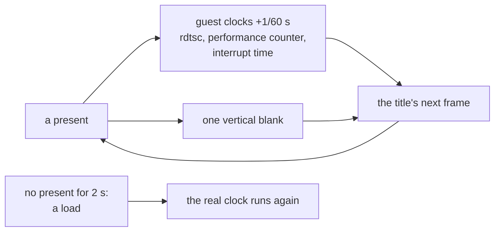

# Test runs

Driving a game with nobody at it, to compare renderers or check a change. All of it is `runtime/core/testdrive`, and
all of it is off unless a variable below is set.

| Variable | Does |
| --- | --- |
| `XBE_PAD_SCRIPT` | A file of `frame BUTTONS [frames held]` lines, `#` for a comment. Frames count presents; held 8 by default |
| `XBE_TEST_DIR` | The run's folder. Read every other frame: a file `cmd` is pressed once and removed, a file `snap` saves the next frame and is removed |
| `XBE_LOCKSTEP` | One vertical blank for each present, and the guest's clocks kept by presents |
| `XBE_BACKGROUND` | The window opens off screen and never takes the focus |
| `XBE_MUTE` | Everything runs, nothing is heard |

`BUTTONS` are joined by `+`: `UP DOWN LEFT RIGHT START BACK A B X Y BLACK WHITE LT RT L3 R3`, `LS LSD LSL LSR` for the
left stick, `RS RSD RSL RSR` for the right, `KEY:<name or #vk>` for a key the game reads itself.

## Lockstep

A renderer that presents slower gets fewer frames in the same time, so two runs of one script reach different game
frames, and a script timed by frames lands somewhere else. Under `XBE_LOCKSTEP` the guest's time is presents, not the
wall clock:

**Figure 1.** What a present moves under lockstep.

The clocks never go backwards. Between presents they run for at most 1/60 s and then hold, so a title that measures a
slow frame sees a normal one. A load presents nothing, so after 2 s the clocks run in real time and vertical blanks
come by themselves, or a title waiting on either would wait for ever.

Audio and anything else on the host's own threads stays on the wall clock. Lockstep makes runs reach the same frames, not
the same bytes: random numbers, threads and anything seeded from the time at boot still differ.

## Frames

`testdrive::SnapAs(name)` saves the next presented frame as `<name>.bmp` in `XBE_TEST_DIR`, top down from the back
buffer as it is about to be shown, under Direct3D 9 and Direct3D 12 alike. A game's own test route calls it. The file
`snap` does the same with a running number.

## Comparing two runs

Two runs of one build do not match byte for byte, even in lockstep: a held weapon sways, guards walk and effects
animate. On one title 8 to 15% of pixels differed between two runs of the same build under Direct3D 9, so "identical"
is not a test a change can pass or fail. Run the build twice as a control, and for a before and after compare where
the differences are as well as how many. The static world should be exactly equal in both pairs, and the before and
after should differ in nothing the control does not. Open any frame that stands out: on that title the largest was a
screen of animated noise.

A difference alone proves little. Keep a count of what the change should do (draws made, draws of each kind), and ask
of a count of 0 whether that check can fire at all.

## Reports

`XBE_REPORT_LOG=from-to,from-to` writes what visibility tests answered in those presents to `reports.log` in
`XBE_TEST_DIR`.
